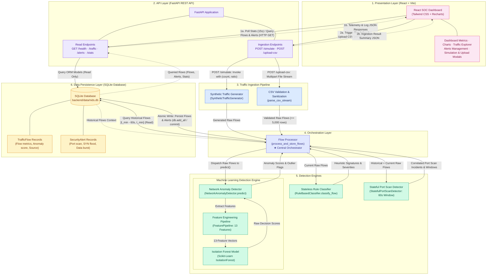

# NIDS — System Architecture & Data Flow

This document details the complete end-to-end architecture, component orchestration, and data flow of the Network Intrusion Detection System (NIDS).

---

## Architecture Diagram

---

## Detailed Data Flow & Component Execution Walkthrough

### 1. Presentation & API Layer Interaction
- **Client-Side Request Initiation**: The React SOC Dashboard (`UI`) communicates with FastAPI (`APP`) exclusively via client-initiated HTTP requests (using Axios in `frontend/src/services/api.js`).
- **Telemetry Polling (Read Flow)**: Every 15 seconds, the dashboard issues an HTTP GET to `/stats` to refresh header KPIs and chart data. When the operator navigates to the Traffic Explorer or Alerts page, the frontend issues paginated GET requests to `/traffic` and `/alerts`.
- **Database Reads**: The read endpoints query SQLite (`backend/data/nids.db`) using SQLAlchemy ORM sessions (`Depends(get_db)`) and return serialized JSON payloads to the frontend.

### 2. Ingestion Triggering & Flow Sanitization
- **Simulation Ingestion**: When the operator clicks "Simulate Traffic" in the UI modal, the frontend issues an HTTP POST to `/simulate` with `total_flows` and `anomaly_ratio`. The endpoint invokes `SyntheticTrafficGenerator.generate_batch()` and forwards the generated raw flow dictionaries to the `Flow Processor`.
- **CSV Ingestion**: When the operator uploads a file, the frontend issues an HTTP POST with multipart form-data to `/upload-csv`. The endpoint routes the byte stream through `parse_csv_stream()` in `csv_service.py`, which validates required headers (`source_ip`, `destination_ip`, `destination_port`, `protocol`), enforces size boundaries ($\le 5\text{ MB}$, $\le 5,000\text{ rows}$), validates IP formatting, and forwards sanitized raw flow dictionaries to the `Flow Processor`.

### 3. Orchestration by Flow Processor
`process_and_store_flows()` in `backend/app/services/flow_processor.py` acts as the **central orchestrator** of the detection and storage pipeline:

1. **Historical Context Retrieval (Read)**:
   - Identifies the earliest timestamp $t_{\min}$ of the incoming batch.
   - Executes a bounded read query on SQLite: `TrafficFlow.timestamp >= (t_min - 60s)` and `TrafficFlow.timestamp <= t_min`.
   - Converts recent entities into historical dictionaries to establish correlation context across batch boundaries.
2. **Stateful Detection Dispatch**:
   - Passes incoming raw flows and historical context to `StatefulPortScanDetector.analyze_flows()`.
   - The detector operates strictly on raw flow metadata (`source_ip`, `destination_ip`, `destination_port`, `timestamp`, `byte_count`, `packet_count`) without touching engineered feature vectors.
   - Returns consolidated vertical port scan incidents.
3. **Machine Learning Dispatch (Complete ML Call Chain)**:
   - `Flow Processor` passes incoming raw flows to `NetworkAnomalyDetector.predict()`.
   - Inside the detector, `FeaturePipeline.transform()` extracts the 13 numerical and behavioral features (`packet_count`, `byte_count`, `duration`, `packet_rate`, `byte_rate`, `avg_packet_size`, protocol one-hot flags, TCP flags, `is_well_known_port`, and `destination_port_scaled`).
   - The resulting 13-dimensional NumPy array is passed to the Scikit-Learn `IsolationForest.decision_function()` model to compute raw decision scores.
   - `NetworkAnomalyDetector` maps the raw scores to normalized anomaly scores $[0.0, 1.0]$ via a sigmoid transformation, evaluates outlier flags (`is_suspicious`), and returns the prediction list to `Flow Processor`.
4. **Stateless Rule Dispatch**:
   - Evaluates each raw flow dictionary individually against `RuleBasedClassifier.classify_flow()` for immediate signature attribution (`SYN Probe`, `SYN Flood Pattern`, `Unusual Large Data Transfer`).
   - Evaluates raw flow keys directly, completely independent of the ML feature pipeline.
5. **Combined Attribution & Deduplication**:
   - Correlates verdicts across all three engines (`is_suspicious = ml_suspicious or rule_triggered or is_stateful_scan`).
   - Assigns detection source attribution (`ML_ISOLATION_FOREST`, `RULE_HEURISTIC`, `STATEFUL_CORRELATION`, or `HYBRID`).
   - For stateful port scan alerts, checks whether an active alert exists in SQLite for the `(source_ip, destination_ip)` pair within the sliding window. If found, updates the alert in-place; otherwise, creates a new `SecurityAlert` linked to the triggering flow.
6. **Atomic Persistence (Write)**:
   - `Flow Processor` is the **only component in the traffic-processing pipeline that persists `TrafficFlow` and `SecurityAlert` records** to SQLite (detection engines do not touch the database).
   - Executes `db.add_all(flows_to_insert)`, `db.add_all(all_new_alerts)`, and `db.commit()` in a single atomic transaction.
   - Returns the processing summary (flow counts, anomalies detected, alerts created) to the FastAPI endpoint, which returns it as JSON to the React frontend.
